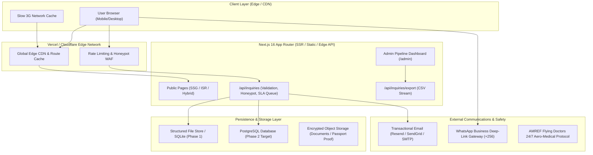

# System Architecture: Pearl Roots & Expeditions

## 1. High-Level Architecture Diagram

---

## 2. Tech-Stack Rationale & Evolution Path

### Phase 1 MVP (Current Live Implementation)
- **Frontend & Framework:** **Next.js 16 (App Router) + React 19 + TypeScript**.
  - *Rationale:* Server-side rendering (SSR) and static generation (SSG) deliver pre-rendered HTML for search engine crawlability and instant First Contentful Paint (< 1.2s) even on throttled 3G networks in rural Uganda.
- **Styling:** **Tailwind CSS v4** with a bespoke natural palette (`forest`, `ochre`, `gold`, `parchment`, `charcoal`). Zero runtime CSS overhead.
- **State & Motion:** **Framer Motion** with `useReducedMotion()` strictly respected for accessibility.
- **Inquiry Engine & API:** Route Handlers (`src/app/api/inquiries/`) with zero-dependency atomic persistence, honeypot traps, sliding-window rate limiting, and 24-hour SLA deadline tracking.
- **Content Architecture:** Structured Content Modules (`src/data/`) acting as a headless-CMS-ready schema layer.

### Phase 2 Evolution (Django REST Framework + PostgreSQL)
- **Backend API:** Django REST Framework (DRF) or Next.js + Prisma/Postgres.
  - *Trade-off analysis:*
    - *Option A (Django REST Framework + Postgres):* Excellent out-of-the-box admin, native Python data analysis, mature permission frameworks, built-in auditing for GDPR/Uganda DPPA. Recommended as team grows past 5 coordinators.
    - *Option B (Full-Stack Next.js + PostgreSQL + Supabase/Prisma):* Minimal operational surface area, unified TypeScript type safety end-to-end, single deployment pipeline. Best for small initial staff (1-3 operators).
- **Object Storage:** AWS S3 or Cloudflare R2 with customer-managed SSE-KMS encryption for sensitive medical declarations and passport proofs.
- **Transactional Communication:** Resend / SendGrid for automated student packs and SLA reminders; Twilio WhatsApp Business API for automated pre-departure alerts.

---

## 3. Risks & Mitigation Matrix

| Identified Risk | Severity | Architectural / Operational Mitigation |
| :--- | :--- | :--- |
| **Voluntourism Backlash & Brand Skepticism** | High | Transparent child safeguarding policies, published supervisory ratios, observational-only medical scope, and fee transparency. |
| **Slow Cellular Bandwidth in Uganda (3G)** | High | Static site generation (SSG), SVG icons, responsive `next/image` WebP encoding, font pre-connection, under 65kB initial JS bundle. |
| **Spam / Bot Form Submissions** | Medium | Invisible honeypot inputs, IP-based sliding window rate limiting (5 per 10m), strict Zod/TypeScript schema parsing. |
| **Data Protection Liability (Uganda DPPA & GDPR)** | High | Phase 1 collects zero passport or sensitive health data on public inquiry form. Phase 2 introduces AES-256 encrypted fields, audit logs, and self-service deletion. |
| **Coordinator Response Bottleneck** | Medium | Built-in 24h SLA response countdown timer on the Admin Dashboard with automatic overdue status alerts. |

---

## 4. Cost Estimate Range (Small-Scale / Year 1)

| Service Component | Provider Recommendation | Low-End (MVP) | High-End (Scale) |
| :--- | :--- | :--- | :--- |
| **Hosting & Edge CDN** | Vercel Hobby / Cloudflare Pages | $0.00 / mo | $20.00 / mo |
| **Database (PostgreSQL)** | Supabase / Neon / Managed RDS | $0.00 / mo | $25.00 / mo |
| **Transactional Email** | Resend / Postmark | $0.00 (Free tier) | $15.00 / mo |
| **Encrypted Document Storage** | Cloudflare R2 / AWS S3 | $0.50 / mo | $5.00 / mo |
| **Domain & DNS** | Cloudflare Registrar | $1.20 / mo ($14/yr) | $2.50 / mo |
| **Total Estimated Run-Rate** | | **~$2 - $5 / month** | **~$60 - $80 / month** |
