# Data Model & API Surface: Pearl Roots & Expeditions

## 1. Entity Relationship (ER) Diagram

```mermaid
erDiagram
    USER ||--o{ INQUIRY : submits
    USER ||--o{ APPLICATION : files
    USER ||--o{ LOGBOOK_ENTRY : records
    USER ||--o{ INCIDENT : reports

    PROGRAM ||--o{ APPLICATION : chosen_for
    PROGRAM ||--o{ PLACEMENT_SITE : operates_at

    PLACEMENT_SITE ||--o{ PLACEMENT : hosts
    APPLICATION ||--o| PLACEMENT : matches_to

    APPLICATION ||--o{ DOCUMENT : contains
    APPLICATION ||--o{ PAYMENT : settles
    APPLICATION ||--o| TOUR_BOOKING : attaches_addon

    TOUR_PACKAGE ||--o{ TOUR_BOOKING : packages

    USER ||--o{ TESTIMONIAL : provides

    USER {
        uuid id PK
        string email UK
        string name
        string role "participant|coordinator|admin|university_contact"
        string phone
        datetime created_at
    }

    INQUIRY {
        uuid id PK
        string interest "student_placement|volunteer|post_safari|leisure_safari|university_partnership"
        string full_name
        string email
        string phone_or_whatsapp
        string country
        string travel_type "individual|group"
        json dynamic_fields "sector, duration_weeks, start_month, safari_addon, university"
        text message
        string status "new|contacted|application_sent|confirmed|completed_lost"
        string assigned_to "coordinator_id"
        text notes
        datetime sla_deadline
        datetime created_at
    }

    APPLICATION {
        uuid id PK
        uuid user_id FK
        uuid program_id FK
        string status "draft|submitted|under_review|matched|accepted|withdrawn"
        json emergency_contact "ENCRYPTED"
        json medical_declaration "ENCRYPTED"
        string university_name
        string academic_level
        boolean safeguarding_signed
        boolean code_of_conduct_signed
        datetime created_at
    }

    PROGRAM {
        string slug PK
        string title
        string sector "medical_healthcare|social_work_education|community_ngo|conservation"
        text description
        string safeguarding_level "high_child_vetted|medical_clinical|community_general"
        boolean active
    }

    PLACEMENT_SITE {
        uuid id PK
        string name
        string location "district, uganda"
        int capacity
        string vetting_status "fully_vetted|conditional|under_review"
        datetime last_reviewed
    }

    PLACEMENT {
        uuid id PK
        uuid application_id FK
        uuid site_id FK
        date start_date
        date end_date
        string local_supervisor_name
        string local_supervisor_contact
        string status "scheduled|active|completed"
    }

    TOUR_PACKAGE {
        string slug PK
        string title
        string type "post_placement_addon|leisure_safari"
        int duration_days
        decimal price_usd
    }

    TOUR_BOOKING {
        uuid id PK
        uuid application_id FK
        string tour_package_slug FK
        date start_date
        date end_date
        int travelers_count
        string status "inquired|reserved|paid"
    }

    PAYMENT {
        uuid id PK
        uuid application_id FK
        decimal amount_usd
        decimal amount_ugx
        string method "stripe_card|mtn_mobile_money|airtel_mobile_money|bank_wire"
        string status "pending|cleared|refunded"
        datetime transaction_time
    }

    DOCUMENT {
        uuid id PK
        uuid application_id FK
        string doc_type "passport|police_check|medical_form|insurance_certificate|cv"
        string s3_storage_key
        string access_level "admin_and_coordinator_only"
        datetime uploaded_at
    }

    LOGBOOK_ENTRY {
        uuid id PK
        uuid user_id FK
        uuid placement_id FK
        date entry_date
        decimal hours_logged
        text activity_summary
        text reflection
        boolean supervisor_signed
        string supervisor_comments
    }

    INCIDENT {
        uuid id PK
        uuid placement_id FK
        string severity "low|medium|high_escalate"
        text description
        text action_taken
        boolean amref_activated
        datetime reported_at
    }

    TESTIMONIAL {
        uuid id PK
        uuid user_id FK
        text quote
        string university_or_origin
        boolean consent_for_public_web
        datetime approved_at
    }

    CONTENT_PAGE {
        string slug PK
        string title
        json page_data
        datetime updated_at
    }
```

---

## 2. API Surface (REST Specification)

### Public Endpoints (Phase 1)
- `POST /api/inquiries`: Submits a new inquiry.
  - **Payload:** `{ interest, fullName, email, phoneOrWhatsApp, country, travelType, dynamicFields, message, botTrap }`
  - **Validation:** Email verification, honeypot (`botTrap` must be empty), rate limit (max 5 per 10m).
  - **Side-effects:** Persists inquiry, computes `sla_deadline = now + 24h`, queues auto-reply acknowledgment email and admin notification.
- `GET /api/inquiries`: Lists inquiries (Admin authorized).
- `PATCH /api/inquiries/[id]`: Updates pipeline status, notes, or assigned coordinator.
- `GET /api/inquiries/export`: Generates on-the-fly CSV of all inquiries for administrative spreadsheets.

### Application & Student Endpoints (Phase 2)
- `POST /api/auth/magic-link`: Sends passwordless email login token.
- `GET /api/applications/me`: Retrieves participant profile, placement matches, and safeguarding status.
- `POST /api/applications/me/documents`: Uploads background check or insurance certificate (pre-signed S3 upload URL).
- `POST /api/tours/addon`: Binds a post-placement safari to an active placement with auto-suggested dates.
- `POST /api/payments/checkout`: Generates Stripe Card or Flutterwave/MTN Mobile Money payment session.

### Coordinator & Logbook Endpoints (Phase 3)
- `GET /api/coordinator/daily-rollcall`: Returns active in-country participants by placement site.
- `POST /api/logbook/entries`: Student logs clinical/service hours and reflective learning.
- `PATCH /api/logbook/entries/[id]/sign`: Local supervisor cryptographically signs or approves logged hours.
- `GET /api/logbook/export-certificate`: Generates official signed PDF certificate of completion for home university credit.

---

## 3. Data Privacy & Encryption Standards
In compliance with the **Uganda Data Protection and Privacy Act 2019** and **GDPR**:
1. **Medical & Sensitive Documents:** Encrypted at rest via AES-256 (SSE-KMS).
2. **Access Control:** Placement supervisors only see necessary dietary/emergency contact info, never passport scans or medical history.
3. **Data Retention:** Verification documents (police checks, passports) are retained for 90 days post-placement completion and purged thereafter.
